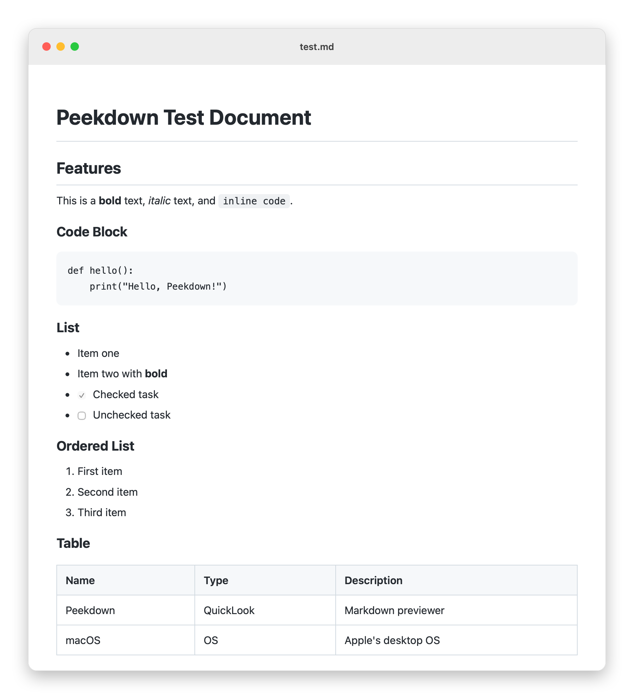
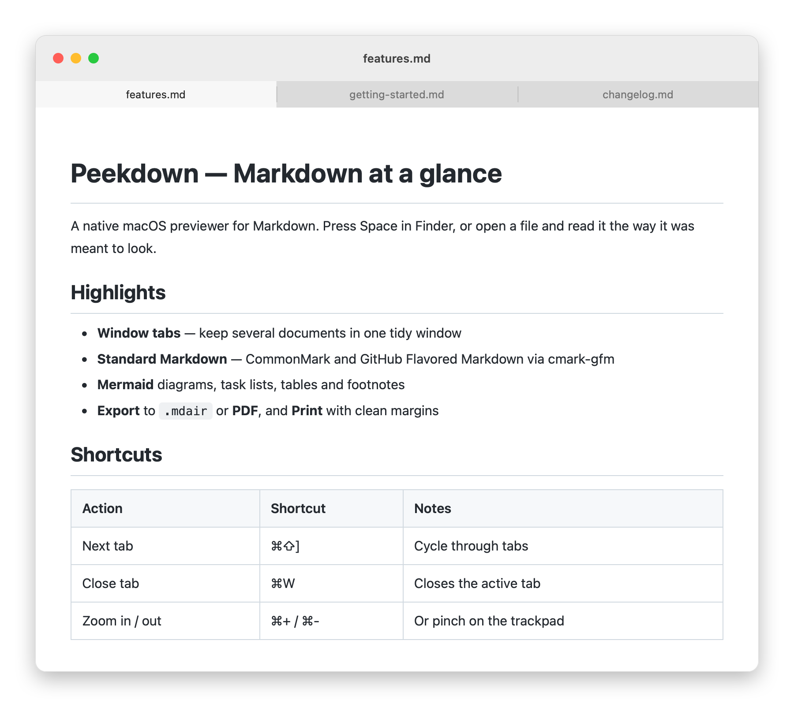
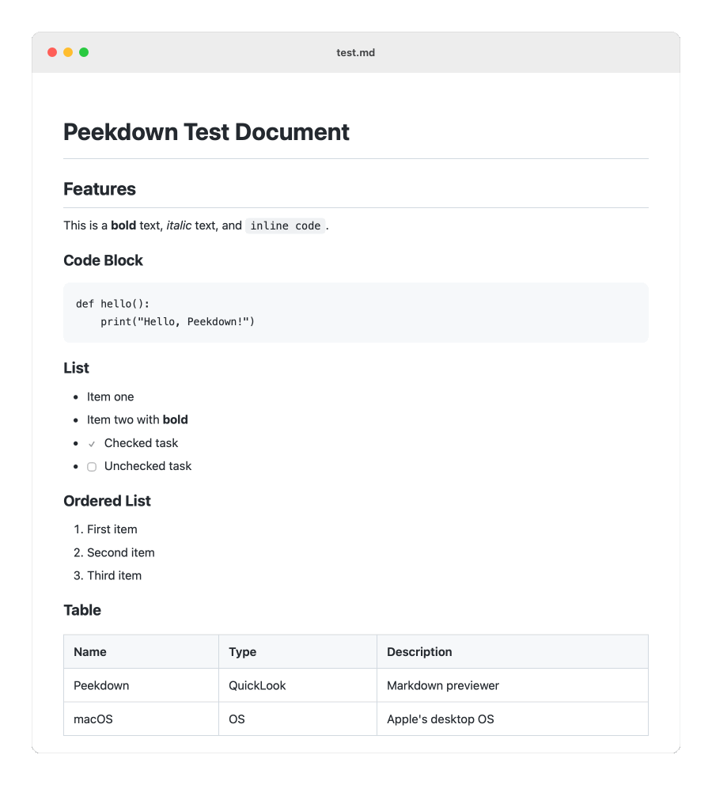
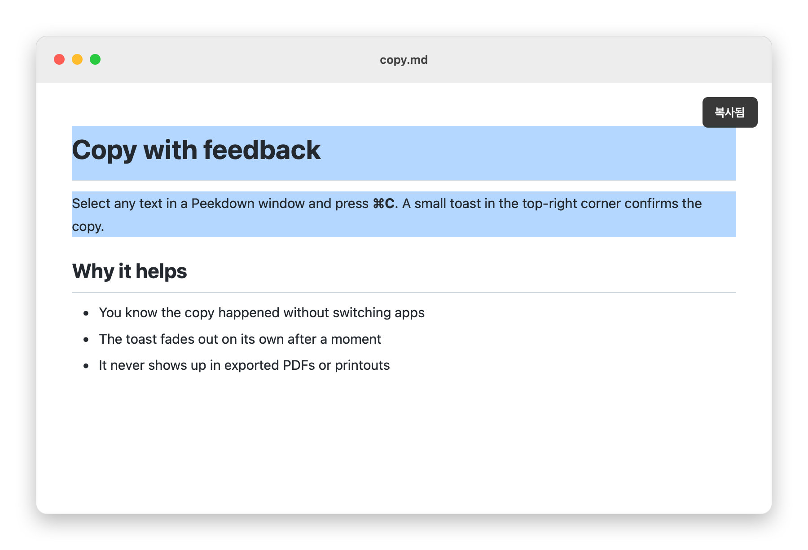

<p align="right">
  <a href="README.md">English</a> · <strong>한국어</strong>
</p>

# Peekdown

<p align="center">
  
  
  <a href="LICENSE"></a>
  
  
  
</p>

<p align="center">
  <strong>Finder에서 마크다운을 바로 미리 보고, 곧 렌더링된 화면에서 바로 편집합니다.</strong>
</p>

> Peekdown은 [tykimos](https://github.com/tykimos)님의 [**mdair**](https://github.com/tykimos/mdair)를 포크해 시작했고, 지금은 별도 프로젝트로 개발하고 있습니다. 바탕을 만들어 주신 원작자께 감사드립니다.

---

<p align="center">
  <picture>
    <source media="(prefers-color-scheme: dark)" srcset="docs/assets/peekdown-preview-dark.png">
    
  </picture>
</p>

**Peekdown**은 마크다운 파일에 QuickLook 미리보기를 더해 주는 가벼운 macOS 네이티브 앱입니다. Finder에서 `.md` 파일을 고르고 `Space`를 누르면 렌더링된 문서가 보이고, Peekdown 창으로 열어 볼 수도 있습니다.

## 기능

| 기능 | 설명 |
|------|------|
| **QuickLook 통합** | Finder에서 `Space`를 누르면 `.md` 파일을 바로 미리 봅니다 |
| **독립 뷰어** | `.md` 파일을 더블클릭하거나 끌어다 놓으면 전용 창에서 열립니다 |
| **창 탭** | 여러 문서를 macOS 기본 탭으로 한 창에 모아 엽니다 |
| **다크 모드** | 시스템 설정에 맞춰 밝은 테마와 어두운 테마가 바뀝니다 |
| **표준 마크다운** | [comrak](https://github.com/kivikakk/comrak)으로 CommonMark와 GitHub Flavored Markdown(표, 체크리스트, 취소선, 자동 링크, 각주)을 지원합니다 |
| **Mermaid 다이어그램** | 오프라인에서도, QuickLook에서도 그려집니다 |
| **안전한 기본값** | 문서에 넣은 스크립트는 실행되지 않고, 문서가 아무 로컬 파일이나 페이지에 싣지 못합니다 |
| **확대·축소** | `⌘+`/`⌘-` 또는 트랙패드 핀치로 확대하고 축소합니다 |
| **복사** | 텍스트를 선택하고 `⌘C`를 누르면 복사했다는 알림이 뜹니다 |
| **TextBundle** | `.textbundle`과 `.textpack` 문서를 이미지와 함께 앱과 QuickLook에서 엽니다 |
| **내보내기** | 파일 메뉴에서 TextPack이나 PDF로 내보냅니다 |
| **실행 의존성 없음** | Electron이나 Node.js 없이 macOS 기본 기능만 씁니다 |

### 창 탭

<p align="center">
  
</p>

여러 문서를 한꺼번에 열면 macOS 기본 탭으로 한 창에 모입니다. `⌘⇧[` / `⌘⇧]`로 탭을 옮겨 다니고, **Window** 메뉴에서 *Merge All Windows*나 *Move Tab to New Window*를 쓸 수 있습니다. `⌘W`는 지금 보고 있는 탭만 닫습니다.

### 확대·축소

<p align="center">
  
</p>

### 복사 알림

<p align="center">
  
</p>

### TextPack과 PDF로 내보내기

**File** → **Export as TextPack…**을 고르면 지금 문서와 문서에 들어간 이미지를 `.textpack` 파일 하나로 묶습니다. [TextBundle](http://textbundle.org)은 Bear, Ulysses 같은 마크다운 앱들이 함께 쓰는 공개 형식이고, TextPack은 이를 ZIP으로 묶은 것입니다. Peekdown은 ZIP 안에 `.textbundle` 폴더째 넣습니다. 로컬 이미지 파일만 담고, 원격 이미지(http, https)는 링크로 남깁니다.

**File** → **Export as PDF…**를 고르면 지금 화면을 A4 PDF로 저장합니다.

## 로드맵

- **여러 운영체제 지원** — 공통 로직은 이미 Rust(`core/`)로 옮겼습니다. 다음으로 앱을 [Tauri](https://tauri.app)로 바꿉니다. macOS의 QuickLook 확장은 그대로 둡니다
- **화면에서 바로 편집** — 편집 창을 따로 두지 않고, Notion처럼 렌더링된 문서에서 바로 고칩니다

## 설치

Peekdown은 **macOS 13.0 이상의 Apple silicon Mac(M1 이후)**에서 돌아갑니다. Intel Mac은 지원하지 않습니다.

아직 미리 빌드한 릴리스가 없습니다. 아래 방법으로 소스에서 빌드한 다음 `build/Peekdown.app`을 `/Applications/`에 복사하세요.

### Gatekeeper 경고 넘기기

Peekdown은 Apple Developer ID로 서명하지 않아서 처음 열 때 macOS가 막을 수 있습니다.

1. `Peekdown.app`을 **오른쪽 클릭** → **열기** → 대화상자에서 **열기**
2. 또는 **시스템 설정 → 개인정보 보호 및 보안**에서 **확인 없이 열기**

### macOS 설정

#### `.md` 파일의 기본 앱을 Peekdown으로 지정

1. Finder에서 `.md` 파일을 **오른쪽 클릭** → **정보 가져오기**(`⌘I`)
2. **다음으로 열기**에서 **Peekdown** 선택
3. **모두 변경...** → **계속**

#### QuickLook 확장이 켜져 있는지 확인

1. **시스템 설정 → 확장 프로그램 → Quick Look**으로 갑니다
2. **QLMarkdownPreview**가 체크돼 있는지 봅니다
3. 목록에 없으면 Finder를 다시 시작합니다: `killall Finder`

## 소스에서 빌드

macOS 13.0 이상의 Apple silicon Mac, Xcode Command Line Tools, [Rust](https://rustup.rs) 1.89 이상이 필요합니다.

```bash
make                        # build/Peekdown.app 생성
make test                   # 빌드하고 전체 테스트 실행 (tests/README.md 참고)
make install                # /Applications에 설치하고, QuickLook이 새로 읽도록 Finder를 다시 띄움
make help                   # 전체 명령 (pkg, dmg, run, notices, clean 등)
```

## 동작 방식

1. **Peekdown.app** — 문서 창. Objective-C(Cocoa + WebKit)로 만들었습니다
2. **QLMarkdownPreview.appex** — 앱 안에 들어 있는 QuickLook 미리보기 확장
3. **peekdown-convert** — 문서와 이미지를 `.textpack`으로 묶는 명령줄 도구(`-o 이름.textbundle`이면 폴더로 저장)

렌더링, TextBundle 읽기, 내보내기는 `core/`의 Rust 라이브러리에 있습니다. 마크다운 해석은 CommonMark 0.31.2와 GFM을 따르는 [comrak](https://github.com/kivikakk/comrak)이 맡습니다. 앱과 확장은 이 라이브러리를 링크해 작은 C 인터페이스(`core/include/peekdown.h`)로 부르고, `peekdown-convert`도 같은 라이브러리로 만듭니다. 화면 스타일은 CSS `prefers-color-scheme`로 macOS의 밝은 모드와 어두운 모드를 따라갑니다.

마크다운 문법(``)으로 넣은 로컬 이미지는 페이지에 담아 보여 줍니다. 로컬 경로를 가리키는 raw HTML `` 태그는 지금은 불러오지 않고, 앱을 Tauri로 옮기면 다시 보이게 됩니다.

QuickLook 확장은 macOS의 엄격한 샌드박스 안에서 돕니다. 문서 옆 파일을 읽지 못해 로컬 이미지 대신 안내 문구가 나오고, 네트워크에 접속하지 못하며, 링크를 브라우저로 열 수 없습니다. 이런 기능은 Peekdown 앱으로 열어서 쓰세요.

## 지원 형식

`.md` `.markdown` `.mdown` `.mkd` `.mkdn` `.mdwn` `.mdtxt` `.mdtext` `.textbundle` `.textpack`

## 라이선스

[MIT](LICENSE). Copyright &copy; 2026 tykimos (원본 mdair), &copy; 2026 HikiJun97 (Peekdown).

오프라인과 QuickLook에서도 다이어그램이 그려지도록 [Mermaid](https://github.com/mermaid-js/mermaid) 11.17.2(MIT)를 함께 배포합니다. 라이선스 전문은 [`resources/mermaid-LICENSE.txt`](resources/mermaid-LICENSE.txt)에 있습니다.

[comrak](https://github.com/kivikakk/comrak) 0.59(BSD-2-Clause)를 비롯한 Rust 크레이트를 함께 배포합니다. 라이선스 전문은 [`resources/THIRD-PARTY-NOTICES.txt`](resources/THIRD-PARTY-NOTICES.txt)에 모아 두었습니다(`scripts/third-party-notices.py`로 다시 만듭니다).
