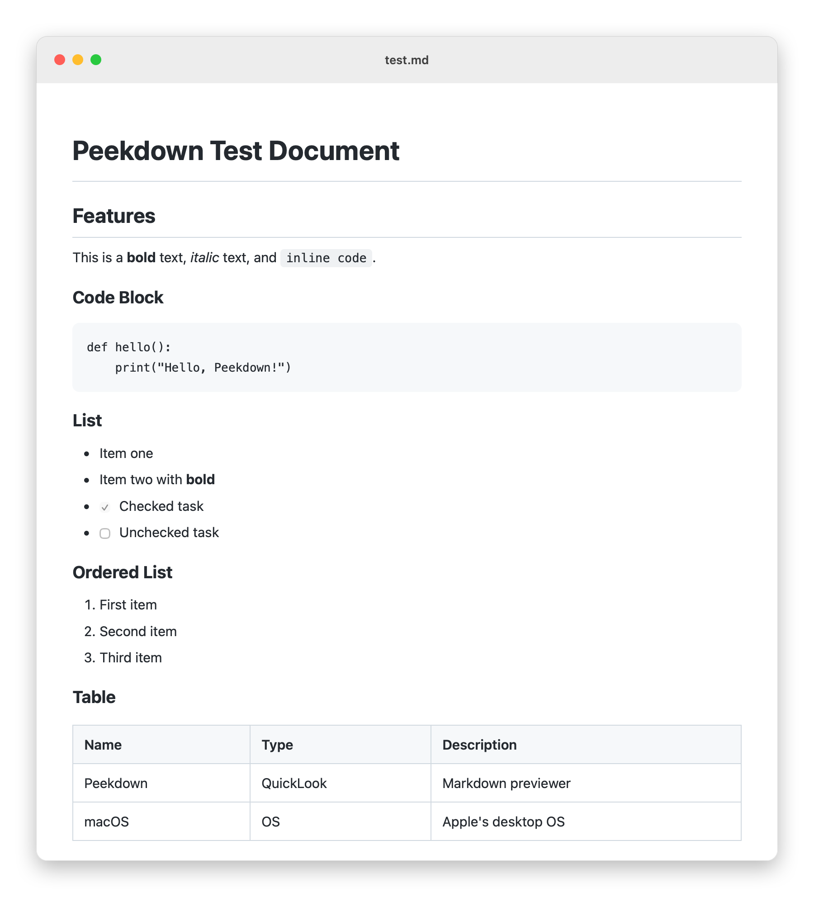
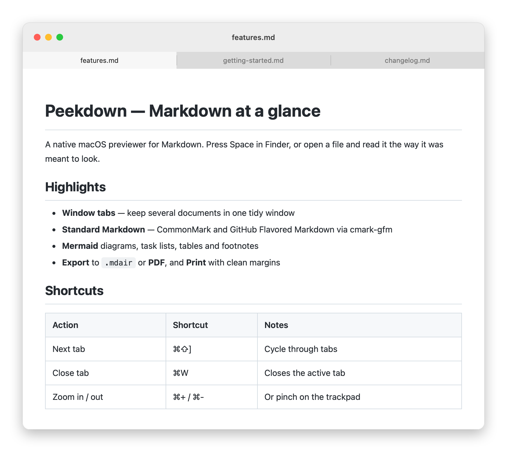
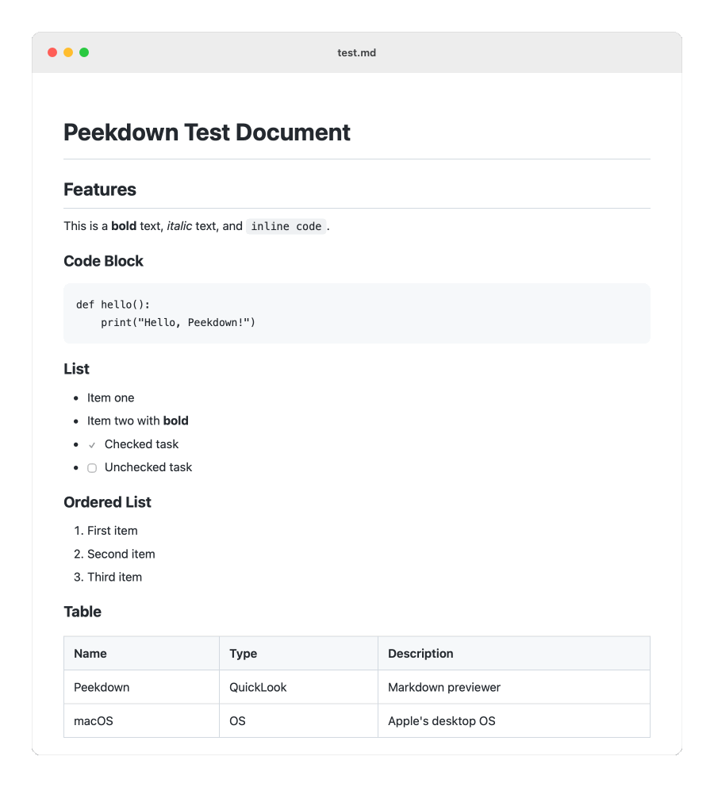
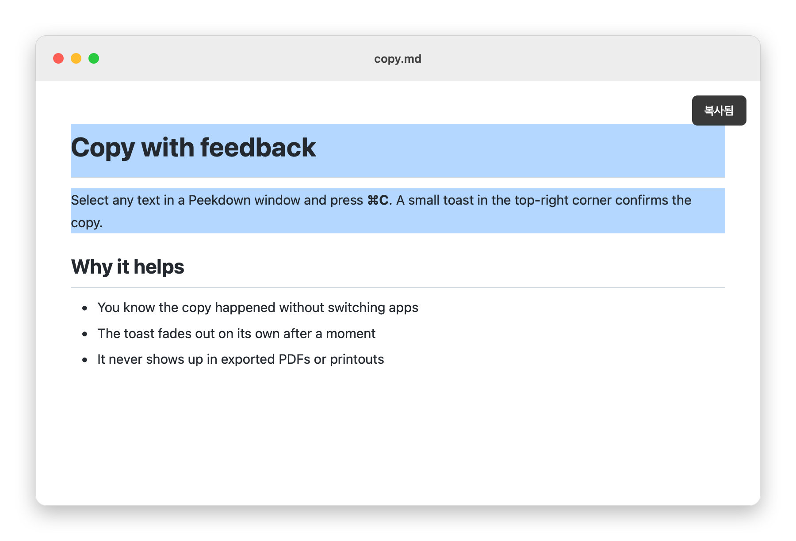

<p align="right">
  <strong>English</strong> · <a href="README.ko.md">Korean</a>
</p>

# Peekdown

<p align="center">
  
  
  <a href="LICENSE"></a>
  
  
</p>

<p align="center">
  <strong>Preview Markdown instantly in Finder — and, soon, edit it right where it's rendered.</strong>
</p>

> Peekdown started as a fork of [**mdair**](https://github.com/tykimos/mdair) by [tykimos](https://github.com/tykimos) and is now developed as a separate project. Thanks to the original author for the foundation.

---

<p align="center">
  <picture>
    <source media="(prefers-color-scheme: dark)" srcset="docs/assets/peekdown-preview-dark.png">
    
  </picture>
</p>

**Peekdown** is a lightweight native macOS app that adds QuickLook preview for Markdown files. Press `Space` on any `.md` file in Finder to see it rendered, or open it in the Peekdown window.

## Features

| Feature | Description |
|---------|-------------|
| **QuickLook Integration** | Press `Space` in Finder to preview `.md` files instantly |
| **Standalone Viewer** | Double-click or drag `.md` files to open in a dedicated window |
| **Window Tabs** | Open multiple documents as native macOS tabs in a single window |
| **Dark Mode** | Automatic light/dark theme matching your system preference |
| **Standard Markdown** | CommonMark + GitHub Flavored Markdown (tables, task lists, strikethrough, autolinks, footnotes) via [cmark-gfm](https://github.com/github/cmark-gfm) |
| **Mermaid Diagrams** | Rendered offline, in QuickLook as well as in the app |
| **Safe by Default** | Scripts embedded in documents never run, and documents can't pull arbitrary local files into the page |
| **Zoom** | Zoom in/out with `⌘+`/`⌘-` or trackpad pinch gestures |
| **Copy** | Select text and `⌘C` to copy — a toast confirms the action |
| **TextBundle** | Open `.textbundle` and `.textpack` documents with their images, in the app and in QuickLook |
| **Export** | Export to TextPack or PDF from the File menu |
| **No Runtime Dependencies** | Pure native macOS — no Electron, no Node.js |

### Window Tabs

<p align="center">
  
</p>

Open several documents at once and they group into a single window as native macOS tabs. Switch with `⌘⇧[` / `⌘⇧]`, and use the **Window** menu to *Merge All Windows* or *Move Tab to New Window*. `⌘W` closes just the active tab.

### Zoom In / Out

<p align="center">
  
</p>

### Copy with Toast Feedback

<p align="center">
  
</p>

### Export to TextPack or PDF

**File** → **Export as TextPack…** bundles the current document and its images into a single `.textpack` file. [TextBundle](http://textbundle.org) is an open format shared by Markdown apps such as Bear and Ulysses; a TextPack is a zipped TextBundle, and Peekdown writes the `.textbundle` folder inside the ZIP. Only local image files are packed; remote images (http, https) stay as links.

**File** → **Export as PDF…** renders the current view as an A4 PDF.

## Roadmap

- **Cross-platform** — move the shared logic to Rust ([comrak](https://github.com/kivikakk/comrak) for Markdown, in `core/`) and the app to [Tauri](https://tauri.app), keeping the QuickLook extension on macOS
- **In-place editing** — edit directly on the rendered document, Notion-style, instead of a separate editor pane

## Installation

Peekdown runs on **Apple silicon Macs (M1 or later) with macOS 13.0+**. Intel Macs are not supported.

There are no prebuilt releases yet. Build from source (below), then copy `build/Peekdown.app` to `/Applications/`.

### Bypassing Gatekeeper

Peekdown is not signed with an Apple Developer ID, so macOS may block it the first time:

1. **Right-click** `Peekdown.app` → **Open** → click **Open** in the dialog
2. Or go to **System Settings → Privacy & Security** → click **Open Anyway**

### macOS Configuration

#### Set Peekdown as the Default App for `.md` Files

1. **Right-click** any `.md` file in Finder → **Get Info** (`⌘I`)
2. Under **Open with**, choose **Peekdown**
3. Click **Change All...** → **Continue**

#### Verify the QuickLook Extension is Active

1. Go to **System Settings → Extensions → Quick Look**
2. Make sure **QLMarkdownPreview** is checked
3. If it doesn't appear, restart Finder: `killall Finder`

## Build from Source

Requires an Apple silicon Mac with macOS 13.0+ and Xcode Command Line Tools. The tests also build the Rust core in `core/`, which needs [Rust](https://rustup.rs) 1.89+.

```bash
./scripts/build.sh          # builds build/Peekdown.app
tests/run.sh                # builds and runs all tests (see tests/README.md)

# Optional installers
./scripts/create-pkg.sh
./scripts/create-dmg.sh
```

## How it works

1. **Peekdown.app** — the viewer window, written in Objective-C (Cocoa + WebKit)
2. **QLMarkdownPreview.appex** — the QuickLook Preview Extension bundled inside the app
3. **peekdown-convert** — a command-line tool that packs a document and its images into a `.textpack` (or a `.textbundle` folder with `-o name.textbundle`)

Markdown is parsed by [cmark-gfm](https://github.com/github/cmark-gfm), GitHub's own CommonMark implementation, vendored as C source under `vendor/` and compiled by `build.sh`. The rendering code is one Swift file shared by the app and the extension. Styling follows macOS light/dark mode via CSS `prefers-color-scheme`.

QuickLook extensions run in a strict macOS sandbox: they can't read files next to the document (local images show a notice instead), can't reach the network, and can't open links in a browser. Open the document in Peekdown for those.

## Supported Formats

`.md` `.markdown` `.mdown` `.mkd` `.mkdn` `.mdwn` `.mdtxt` `.mdtext` `.textbundle` `.textpack`

## License

[MIT](LICENSE). Copyright &copy; 2026 tykimos (original mdair), &copy; 2026 HikiJun97 (Peekdown).

Bundles [Mermaid](https://github.com/mermaid-js/mermaid) 11.17.2 (MIT) so diagrams render offline and in QuickLook. See [`resources/mermaid-LICENSE.txt`](resources/mermaid-LICENSE.txt).

Bundles [cmark-gfm](https://github.com/github/cmark-gfm) 0.29.0.gfm.13 (BSD-2-Clause and others). See [`vendor/cmark-gfm/COPYING`](vendor/cmark-gfm/COPYING).
